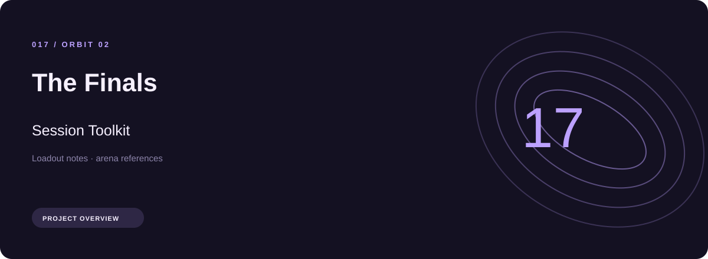
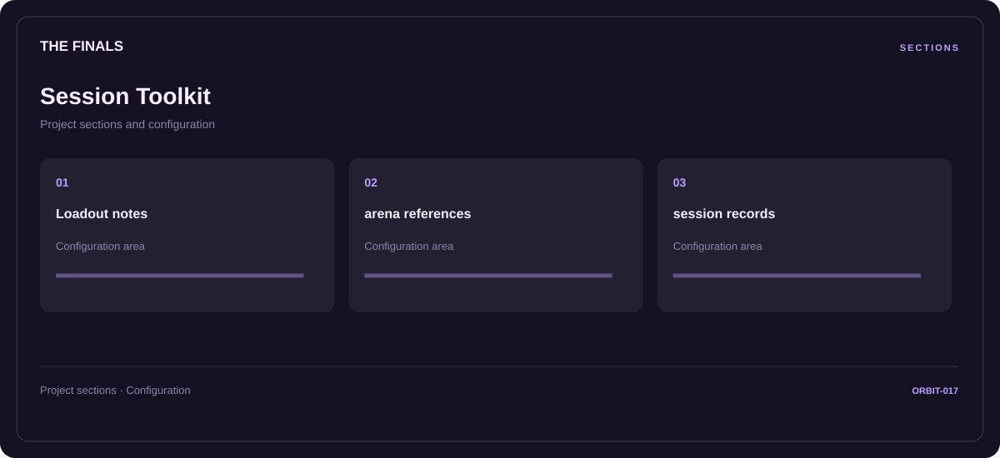

# 🎮 The Finals Session Toolkit

**Loadout notes · Arena references · Session records**

## ⚡ Features

The The Finals session toolkit workflow separates loadout notes from arena references and session records. Named sections make the available options easier to find.

### ⚙️ Loadout notes

Equipment categories and the associated selection or configuration options.

### 🧩 Arena references

A dedicated section for arena references and the configuration details associated with that area.

### ⌨️ Session records

Session and activity information grouped by the task or context it belongs to.

## 🖥️ Project navigation

## 📥 Download

The button and cover open the project's download page. Use the information supplied with the downloaded package for installation and release-specific requirements.

## 📚 Project documentation

- [Feature reference](docs/FEATURES.md)
- [Download information](docs/DOWNLOAD.md)
- [Project page](index.html)

---

The Finals Session Toolkit · Program documentation and download information.
